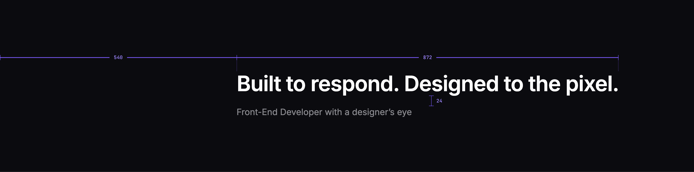

## Hi, I'm Eslam 👋

**Front-End Developer with a designer's eye.**

I started as a graphic designer, and I still care about every pixel, spacing, typography and color. Now I turn designs into responsive, accessible websites that look exactly like the design, on every screen size.

<br />

### What I work with


**Design tools:** Photoshop · Illustrator

<br />

### What I bring

- Pixel-accurate implementation of designs
- Responsive, mobile-first layouts with Flexbox and Grid
- Clean, semantic and accessible HTML
- A strong eye for visual design: spacing, typography and color

<br />

### Roadmap

```
HTML & CSS  ●━━━━━━━━  done
JavaScript  ●━━━━━○──  in progress
React       ○────────  next
TypeScript  ○────────
Next.js     ○────────
```

<br />

### Let's connect

[](https://www.linkedin.com/in/eslamshaban-dev)

Open to front-end roles: full-time, part-time or freelance, remote or on-site.
